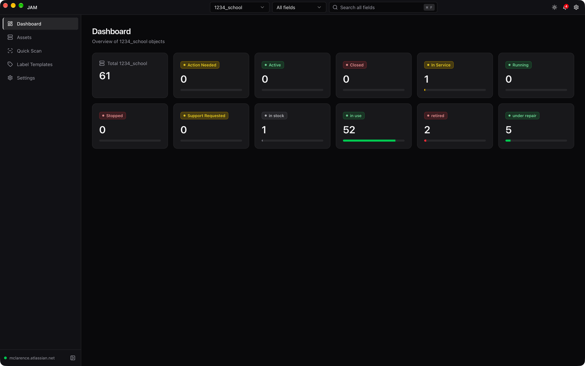
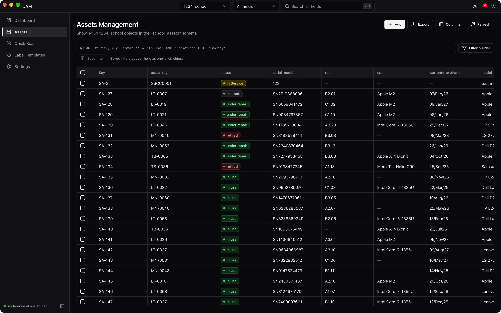
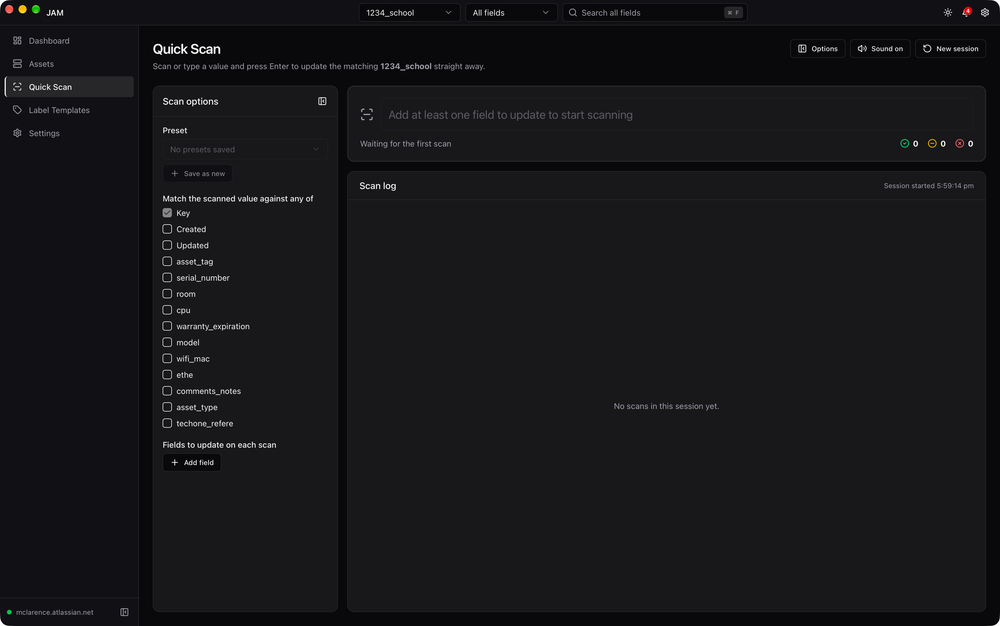
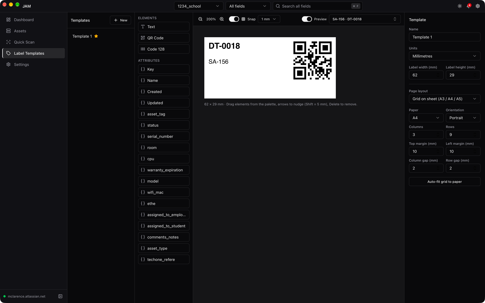
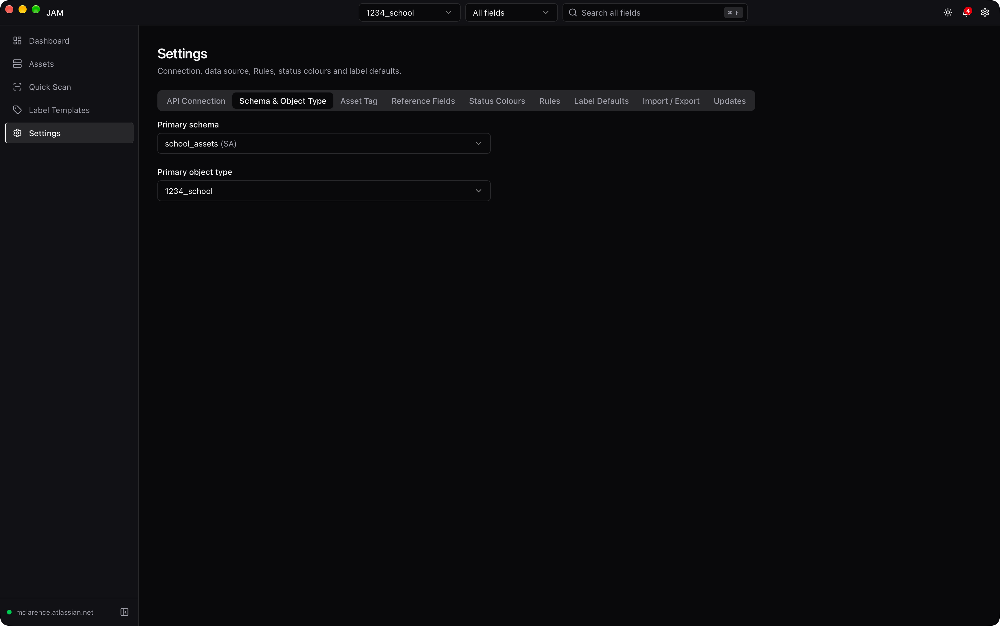

# JAM — JIRA Assets Manager

A cross-platform desktop app (Windows, macOS, Linux) for managing IT assets stored in **Jira Assets** (formerly Insight). It provides a fast, editable data grid, a quick-scan workflow for barcode scanners, and a visual label designer with batch printing.

> [!WARNING]
> **This project is fully AI-generated ("vibe coded").** The code, configuration and this documentation were produced by an AI assistant with human direction and light review. It has not had a formal security audit or thorough testing. Review the code before using it against production data, and use at your own risk.

## Screenshots

| Dashboard | Assets grid |
| --- | --- |
|  |  |

| Quick Scan | Label designer |
| --- | --- |
|  |  |

| Settings | |
| --- | --- |
| |

## Features

### Assets grid
- Browse every object of the selected schema and object type in a virtualised table (TanStack Table), so large datasets stay responsive.
- **Inline editing**: double-click a cell to edit text, numbers, dates, status, select and object-reference attributes. Edits are applied optimistically and rolled back with an error toast if the API call fails.
- **Reference picker**: debounced, searchable autocomplete for object-reference attributes (users, other assets).
- **Detail drawer**: view all attributes, revision history and linked objects of an asset.
- **Create asset** dialog, with optional automatic **asset tags** (see Settings).
- **Batch update**: change an attribute across multiple selected rows at once.
- **Inline column bulk editing**: hold **Ctrl** (Windows/Linux) or **Cmd** (macOS) and drag through cells in one editable column. Repeat the gesture to add more ranges in that column, then double-click any highlighted cell to open its usual editor. Releasing the mouse only keeps the highlights; committing the editor applies one value to those assets, independently of checkbox selection. Choosing the clicked cell's existing value still updates other highlighted cells. Optional student/object references can also be cleared. Existing batch rules apply; progress, per-asset errors and **Retry failed** are shown. System, multi-value and other currently read-only attributes stay read-only.
- Clear cell highlights with **Escape**, **Clear highlights**, or a plain click outside them. Starting a modifier-drag in another column replaces the selection; changing the search, filter, sort, object type or connection, leaving the page, or hiding the selected column clears it. During editing, Escape cancels the editor without saving; a second Escape clears highlights. A changed table context disables retries of a previous failed batch.
- **Column drawer**: show, hide and reorder columns; preferences persist.
- **Search and filtering**: global quick search, an attribute filter builder, and a raw **AQL** (Assets Query Language) input. AQL filters can be saved as named presets.
- **Status colour-coding**: status values render as badges whose colours you can map per status name.

### Dashboard
Total object count plus a per-status breakdown for the selected object type. Clicking a status jumps to the grid filtered to that status.

### Asset CSV export
Use **Export** above the grid or **Export selected** in the selection bar. Choose selected assets or **all matching results across every page**, then visible columns in table order or all available attributes in metadata order (including columns you hid, but excluding Jira-hidden attributes). Selected assets are the default when available; visible columns are the default. No extra Key/Label columns are added.

Export reads fresh asset details without changing the table's selection or loaded pages. References, statuses and users use readable names, while numbers, booleans and ISO dates retain API values. Multiple values share one comma-separated cell. CSV files are UTF-8 with Unicode and multiline support.

Progress and Cancel are available with no fixed row cap. The native save dialog opens only when all requested assets have been read; errors can be retried and no partial file is offered. Changing the query, object type or connection cancels the export. Large exports depend on available memory. This is not a server-side point-in-time snapshot: assets may change while exporting. Export requires the desktop app, like the existing Jira connection.

**Spreadsheet warning:** CSV text is preserved exactly, including values starting with `=`, `+`, `-` or `@`. Spreadsheet applications may interpret these as formulas. Only open trusted exported data.

### Quick Scan
Built for handheld barcode/QR scanners. Scan or type a value and press Enter to look up the matching asset and apply a pre-configured set of changes immediately.
- Choose which attribute to match against (Key or any text attribute).
- Define one or more actions (set a field to a value, clear it, or set a date/time to "now").
- Save and reuse action sets as presets (for example "Return to stock").
- Per-scan result log showing updated, unchanged and failed scans, with optional audio feedback.

### Rules
Rules automatically set or clear attributes as part of saves made in this app. Open **Settings → Rules**, select a schema and object type, then create, edit, enable, disable, delete or reorder rules. Rules are stored for the Jira workspace and object type and, with [settings sync](#settings-sync) on, sync to your other devices including the iOS app. They do not run for changes made in Jira or another client. Desktop settings exports can include rules.

### Deleting assets

Open **Settings → Deletion** for the selected object type and save a method. Deletion is unavailable by default. Configuration is local to the Jira cloud/workspace and object type, persists across restarts, can be included in desktop settings backups, and syncs to your other devices including iOS when [settings sync](#settings-sync) is on.

- **Permanently delete** sends Jira's actual object `DELETE` request. Jira object-delete permission and the appropriate API token scope (`delete:cmdb-object:jira` for scoped tokens) are required. Permission failures are shown, never silently replaced by soft deletion.
- **Soft delete** sets a required editable, single-valued text or select marker to your chosen value, for example **Asset Tag = DELETED**. Optionally update another supported editable attribute/value, such as **Status = Retired** or **Room = Retired storage**. Both changes are sent together; edit rules do not run and cannot overwrite the marker. Jira validation/permission errors leave the asset visible. A unique marker attribute may reject reusing the same marker value on multiple assets; choose a non-unique field if needed.

Open an asset's details and choose **Delete asset**, then confirm the described action. The app waits for Jira success before removing the asset and refreshing caches/counts. To delete several assets, tick their checkboxes in the Assets table (or **Select all matching**) and choose **Delete N** in the selection bar. Each object is deleted independently with the saved method (up to four at a time, retrying rate limits); failures are listed with their Jira error and can be retried without repeating successful deletions. Selected objects of a different object type are skipped with an error. Marker matches are excluded server-side before list pagination, searches, dashboard counts and exports (including selected exports). Existing marker matches stay hidden when switching to permanent deletion. Changing the marker attribute/value, replacing/importing configuration, or removing local settings can reveal previously soft-deleted objects; no Jira object is restored or modified by changing settings. Restore a soft-deleted object by changing its marker in Jira. Changes outside this app remain subject to Jira search-index lag.

Each rule selects the operations to run on, the attributes to watch, an **any** or **all** group of conditions, and actions to set or clear attributes. New rules run on individual edits, batch updates and Quick Scan; object creation is opt-in. For example, watch **Assigned to Employee**, **Assigned to Student** and **Room**; add an **is set** condition for each using **any**; then set **Status** to **Active**.

Under **Then set or clear these attributes**, choose **Set value** to enter a fixed value, or **Clear value** to remove an optional attribute's value without entering one. A blank Set value input is invalid, not a clear action. Required attributes cannot be cleared; this is checked again against current metadata before execution. Actions still target supported editable single-valued attributes. A rule can mix set and clear actions. Existing saved rules and older settings imports keep their Set value behavior; exports containing clear actions require a version that supports them.

At least one watched attribute must actually change in the user's save. Conditions see the existing object with the user's changes applied, including clears. All rules evaluate that same snapshot: actions do not trigger other rules, and later matching rules win if they target the same attribute, even over a manually entered value. Presence conditions can inspect multi-valued and read-only attributes. Clearing an already-empty attribute during an update is a no-op. Creation starts with an empty object, and the create form's required fields must still be supplied manually. A matching creation clear is sent explicitly, including when it overrides a manually entered optional value; Jira still controls server defaults and constraints.

Invalid applicable rules block the affected save with an error; other assets in a batch can still succeed. Following a successful rule-driven save, the grid and open detail are updated automatically from the refreshed object. Filters or pagination may exclude the object from the grid. If the save succeeds but refresh fails, the app warns that the display may be stale and offers a retry; refresh before editing that asset again rather than repeating the save.

Rules are client-side, not server-side automation or an atomic compare-and-set. They have no schedules, scripts, nested condition groups or dynamic action values, and cannot use server defaults when evaluating creation. Concurrent edits from other clients may occur between the app's read and write.

### Label templates and printing
- **Visual designer** with drag/resize handles and snapping.
- Units in mm, inches or px; single-label or sheet layouts (A3/A4/A5 grids) and continuous label sizes.
- Rich text elements with placeholders bound to asset attributes (for example `${Key}`, `${Name}`, `${Serial Number}`).
- **Code 128** and **QR code** elements, rendered as vector SVG for sharp output on 300/600 DPI printers.
- Create, duplicate, rename, edit and delete templates; mark one as the default.
- Select rows in the grid and use the sticky action bar to print with the default template, or pick another from the split menu. Output is a PDF that is saved to disk or opened in the system viewer.

### Reports
- **Report builder**: pick a data source and what to report on (**Assets** or **History** changes), then add filter chips (date ranges such as "last 3 months", people, assets, categories, statuses, any attribute), nested AND/OR groups, up to 2 groupings (including by day, week or month) and measures (count, count with value, distinct count, sum, average).
- **Views**: switch between a sortable, paged table, KPI cards, and bar, line and breakdown (pie) charts without re-running. Views that don't suit a result are disabled with the reason.
- **Saved reports**: save, duplicate and rename reports, including filters, groupings, columns and view settings. Export results to CSV or JSON, or save a printable PDF summary.
- **Example**: to see how often a student borrowed anything, report on History, filter *Object added* is the student and *Changed at* is in the last 90 days, then group by week. Every borrowing is counted, whichever asset it was.
- **Past versus current assignments**: to compare all past borrowers, group by the historical *Assigned to student (added)* field and filter it to *is not empty*, with your date range. Fields labelled *(current)* use the latest collected assignment, not the borrower at the time of each change. Historical reference fields are generated for every reference attribute; existing saved reports keep their current-value behavior until you change their fields.
- **Reference labels**: history recorded as names is included as-is without matching. References display labels rather than appended object keys. **Match names** is optional, for linking a recorded name to a known object's history; existing cached history is updated locally without fetching from Jira.
- **Jira usage**: reports run against a local database on this device and never call Jira. Data is only fetched when you press **Refresh** and confirm an estimate of the requests. Only the object types and optional AQL scope chosen for the data source are collected. Later refreshes only fetch history for new or changed assets, with request limits (4 concurrent, 5 per second by default), back-off on rate limiting, and resume after interruption. A full refresh is allowed once an hour.
- **Privacy**: collected data and name matches stay on this device until you clear them (Refresh → Clear local data). They are never synced or backed up. Report templates and data source definitions can be included in sync and settings backups.

See [docs/reports.md](docs/reports.md) for the architecture and how to add data sources, filters, measures and charts.

### Settings
- **Connection**: Atlassian site URL, account email and API token. The token is stored in the OS credential vault (Keychain, Credential Manager, Secret Service) and is never exposed to the web UI.
- **Network**: optional proxy URL, option to accept invalid certificates, and a "web proxy sign-in" flow for networks where a filter (for example Zscaler) requires a browser login first.
- **Schema**: pick the primary schema and object type.
- **Asset tag**: per-object-type template (for example `SSCCXXXXX`) that auto-generates the next zero-padded tag.
- **Status colours**: map status names to colours.
- **Rules**: configure ordered, workspace-specific attribute automation.
- **Label defaults**: default template, unit, label size and print action.
- **Backup**: export and import settings to a JSON file, with optional passphrase encryption (Argon2-derived key). Connection details are only included in, and restored from, encrypted exports.
- **Updates**: built-in updater with stable and nightly channels.
- **Sync**: end-to-end encrypted settings sync between devices; see [Settings sync](#settings-sync).

### Settings sync

Open **Settings → Sync** and sign in with Google, then choose a sync password (at least 8 characters). On each other device, sign in with the same Google account and enter that password. Settings are encrypted on the device with a key protected by your password (Argon2id, XChaCha20-Poly1305) and stored in the app's hidden Google Drive app-data folder, so Google cannot read them. There is no password recovery: **Reset sync** starts again with this device's settings and a new password, and other devices must then enter the new password.

| Syncs with | Settings |
| --- | --- |
| All devices (desktop and iOS) | Site URL and email, selected schema and object type, theme, saved filters, status colours, columns, asset tags, reference fields, rules, deletion settings, Quick Scan settings |
| Other computers only | Label templates and default template, label defaults, column widths, update settings, report templates and data sources (unchecked by default) |
| Never | Jira API token (enter it on each device), network/proxy options, the Google sign-in itself |

#### Choose what syncs on each device

Use the **Sync on this device** checkboxes and **Confirm sync choices** before enabling sync. After this update, previously enrolled devices also pause until you confirm their categories. Supported categories start checked, but nothing starts syncing until you confirm and review any differences.

Uncheck a category to stop both incoming changes and outgoing edits on this device. Existing local settings and cloud records stay intact, and other devices keep syncing that category. For example, exclude **Columns** on iOS to keep its own visibility/order while desktop clients continue sharing visibility/order and desktop-only widths. Rules and their order stay together; Quick Scan settings, presets and sound stay together; label templates/defaults are desktop-only. **Report templates and data sources** is unchecked by default; collected report data and name matches never sync. Deleting a synced data source on another computer removes it here but leaves its collected data until you clear it on this computer.

Save changes to the checklist whenever you want. Newly enabled categories show a review with explicit **Keep this device's version** or **Use synced version** choices, including removals/defaults. Keeping local settings can update other devices. Cancel leaves those categories disabled; interrupted reviews remain gated after restarting. Uncheck everything to pause settings sync without signing out. Choices are local to this installation, retained across sign-out and sync reset, and never included in synced settings or portable backups.

Excluded categories may still be downloaded/decrypted as part of older mixed-category encrypted files, but are never applied or uploaded by this device. Exclusion does not erase previously uploaded data and cannot recall an upload already in progress when you save your choices.

Label templates and other desktop-only features are synced in a desktop-only scope that the iOS app never downloads or changes, so iOS keeps working normally without them. Changes sync automatically a few seconds after you make them and every few minutes while the app is open; **Sync now** runs immediately. The first sync on a device shows a preview before merging. If two devices change the same setting before syncing, you choose which version to keep. A synced connection is only suggested on a new device: you still enter your API token there. The protocol is specified in [docs/sync-protocol.md](docs/sync-protocol.md).

### Other
- Frameless custom title bar with native window controls.
- Light and dark themes (follows the system by default).
- Keyboard shortcuts: `Ctrl/Cmd + F` focuses search, `Ctrl/Cmd + ,` opens Settings, `Esc` dismisses dialogs or cancels a cell edit.

## Requirements

JAM talks to the **Jira Assets REST API on Atlassian Cloud**, so you need:

- An Atlassian Cloud site with Jira Service Management Assets enabled.
- An [Atlassian API token](https://id.atlassian.com/manage/api-tokens) for an account that can access the assets workspace.

## Installation

Download the installer for your platform from the project's GitHub Releases page:

| Platform | Artifact |
| --- | --- |
| macOS (Apple Silicon) | `.dmg` |
| Windows | NSIS `.exe` installer |
| Linux | `.AppImage` |

Nightly builds are available through the in-app update channel selector (Settings → Updates).

> Builds are not code-signed or notarised. macOS and Windows may show a security warning on first launch.

### macOS: clearing the quarantine flag

Because the app is not notarised, macOS may report it as "damaged" or block it from opening. After dragging `JAM.app` to `/Applications`, clear its quarantine attribute:

```sh
xattr -cr /Applications/JAM.app
```

Replace `/Applications/JAM.app` with the actual path to `JAM.app` if you installed it elsewhere.

## Usage

1. Open **Settings → Connection** and enter your site URL (`https://your-site.atlassian.net`), account email and API token, then click **Connect**.
2. Open **Settings → Schema** and choose the primary schema and object type.
3. Optional: configure **Asset tag**, **Status colours** and **Label defaults**.
4. Use **Dashboard** for an overview, **Assets** to browse and edit, **Quick Scan** for scanner workflows, and **Templates** to design labels.
5. To print labels, tick rows in the Assets grid and use **Print X Labels** in the action bar.

## Building for development

### Prerequisites

- [Node.js](https://nodejs.org/) 20 or newer
- [pnpm](https://pnpm.io/)
- [Rust](https://www.rust-lang.org/tools/install) (stable toolchain)
- Platform dependencies for [Tauri 2](https://tauri.app/start/prerequisites/):
  - **macOS**: Xcode Command Line Tools (`xcode-select --install`)
  - **Windows**: Microsoft C++ Build Tools and WebView2
  - **Linux** (Debian/Ubuntu):
    ```sh
    sudo apt-get install libwebkit2gtk-4.1-dev libappindicator3-dev librsvg2-dev patchelf libdbus-1-dev pkg-config libssl-dev
    ```

### Run

```sh
git clone https://github.com/mclarence/JAM.git
cd JAM
pnpm install

# Full desktop app with hot reload
pnpm tauri dev

# Frontend only (browser, no native features) on http://localhost:1420
pnpm dev
```

### Checks and production build

```sh
pnpm typecheck                 # TypeScript
pnpm test                      # Frontend unit and integration tests
pnpm exec playwright install chromium webkit # Once, for browser tests
pnpm test:browser              # Mocked inline bulk editing in Chromium and WebKit
(cd src-tauri && cargo check)  # Rust

pnpm tauri build               # installers in src-tauri/target/release/bundle
```

### Settings sync: Google OAuth client

Settings sync is unavailable unless the build includes a Google OAuth client ID. In one [Google Cloud project](https://console.cloud.google.com/) (shared with the iOS app, so both use the same Drive app-data folder):

1. Enable the **Google Drive API**.
2. Configure the OAuth consent screen and add the scopes `.../auth/drive.appdata`, `openid` and `email`. While the app is in testing, add your Google accounts as test users.
3. Create an OAuth client of type **Desktop app**. Its secret is not confidential for installed apps, but Google requires it for desktop clients.
4. Build with the client details in the environment (they are compiled in):

```sh
JAM_GOOGLE_CLIENT_ID=1234-abc.apps.googleusercontent.com JAM_GOOGLE_CLIENT_SECRET=GOCSPX-... pnpm tauri build
```

The release and nightly workflows read the `JAM_GOOGLE_CLIENT_ID` and `JAM_GOOGLE_CLIENT_SECRET` repository secrets.

### macOS app signing in CI

The [release](.github/workflows/release.yml) and [nightly](.github/workflows/nightly.yml) workflows require the same persistent, self-signed code-signing identity for macOS builds. Export the identity, including its private key, from Keychain Access as a password-protected `.p12`, then add these repository secrets under **Settings > Secrets and variables > Actions**:

| Secret | Value |
| --- | --- |
| `MACOS_CERTIFICATE_P12` | Base64-encoded `.p12` contents (`base64 -i signing.p12 \| pbcopy` on macOS) |
| `MACOS_CERTIFICATE_PASSWORD` | Password protecting the exported `.p12` |
| `MACOS_SIGNING_IDENTITY` | Exact certificate name shown by `security find-identity -v -p codesigning` |

Never commit the certificate, private key or encoded contents. Keep a secure backup of the identity and reuse it for every nightly, release and local build; recreating it changes the app's signing identity. For local builds, set `APPLE_SIGNING_IDENTITY` to the same certificate name.

On the disposable GitHub-hosted macOS runner, the workflows import the identity into a temporary keychain, trust its certificate for code signing, verify it is available, and pass it to Tauri through `APPLE_SIGNING_IDENTITY`. Missing or invalid signing secrets fail the macOS build rather than producing an unsigned update. Temporary keychain and certificate files are cleaned up even after build failure. Windows and Linux builds are unchanged.

This signing is separate from updater signing below. It does not provide Apple notarization or remove Gatekeeper warnings on other Macs. Existing Keychain items may need one final **Always Allow** approval; verify access by updating between two builds signed with the same identity.

### Updater signing

Release builds are signed for the auto-updater. Generate your own key pair and replace `plugins.updater.pubkey` in [src-tauri/tauri.conf.json](src-tauri/tauri.conf.json):

```sh
pnpm tauri signer generate
```

## Project structure

```
src/            React + TypeScript frontend
  api/          Jira Assets API client, types and TanStack Query hooks
  components/   assets grid, label designer, quick scan, reports, settings, UI primitives
  lib/          AQL helpers, asset tags, batch update, quick scan logic, report model/filters/visuals
  pages/        Dashboard, Assets, Quick Scan, Reports, Templates, Settings
  store/        Zustand stores (settings, templates, theme, updater, ...)
src-tauri/      Rust host: credential storage, HTTP/proxy, backup crypto, PDF files, updater, reports engine (SQLite)
docs/           Jira Assets API spec, auth notes, sync protocol, reports guide
.github/        Release and nightly CI workflows
```

## Tech stack

Tauri 2 (Rust), React 19, TypeScript, Vite, Tailwind CSS 4, Radix UI, TanStack Query / Table / Virtual, Zustand, Recharts, SQLite (rusqlite), bwip-js, jsPDF.

## License

Released under the [GNU General Public License v3.0](LICENSE).
